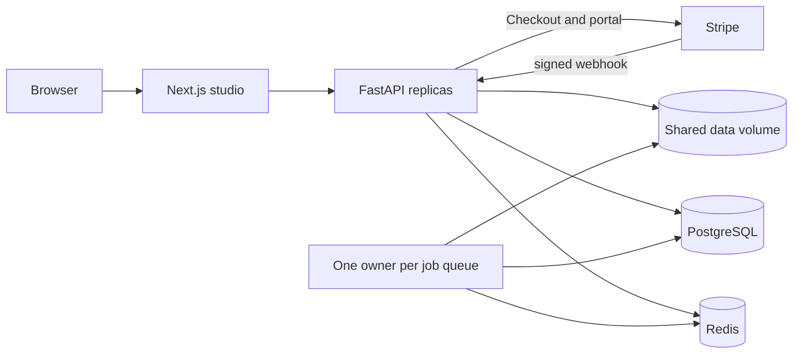

# Current architecture

The checked-in code, migrations, and this document describe the implemented system.
`Bondeth_AI_Master_Blueprint.pdf` is the original October 13 proposal. Preserve it as
history: its single-file example, F5-TTS choice, wildcard CORS, microservice diagram,
infrastructure prices, and sub-two-second latency goal do not describe this release.

## Runtime

Bondeth AI is a modular FastAPI application plus a Next.js App Router frontend.
REST handles account/library operations and generation; SSE replays long STT job
events; WebSockets carry microphone PCM and partial/final dictation results.

The default deployment runs STT and clone workers as threads inside FastAPI. The
split-worker Compose override runs them in `python -m app.worker`; API replicas
disable both embedded workers. Both modes use the same queue code and data paths.

## Inference

| Capability | Default implementation | Alternative |
| --- | --- | --- |
| Khmer STT | Fine-tuned Khmer Whisper, directly through CTranslate2 | Configurable pinned Khmer model |
| English STT/detection | faster-whisper large-v3-turbo | Configurable model/device |
| TTS | MMS Khmer/English voices, normalized script runs | VoxCPM2 multilingual house voice |
| Clone | OmniVoice with a provided or internally transcribed reference | VoxCPM2 |

Automatic STT routes confidently English audio to English and otherwise to Khmer.
This is a two-language routing heuristic, not unrestricted language identification.
Live dictation repeats inference over a rolling window and finalizes at pauses;
CPU deployments should disable partial previews when they cannot keep up.

MMS and OmniVoice pretrained weights have noncommercial restrictions documented in
the README. Billing configuration requires both generation engines to be VoxCPM2.
TTS and cloning wrappers share a generation lock for the process-wide VoxCPM model.
Separate API processes still load separate models and consume separate memory.

## Persistence and recovery

PostgreSQL stores users, voice metadata and consent timestamps, transcription
history, hashed API keys, per-key daily usage, subscription state, and webhook IDs.
Redis stores expiring auth tokens, quotas, TTS audio cache, job hashes, waiting and
processing lists, and STT event streams. Audio/model files live on persistent volumes.

Job admission checks queue capacity and writes the job/list entry in one Lua
operation. Jobs reserve quota before submission and settle/refund after work.
Pro jobs use a priority list; after three priority jobs the scheduler tries a
regular job. Priority does not interrupt a running model call. Positions are estimates.

A file lock on the shared data volume prevents two workers from owning/recovering
the same queue. It lasts until the worker thread actually exits, including during
shutdown. Interrupted nonterminal jobs are recovered at the next owner startup;
terminal records left in the processing list are not rerun. Execution is at least
once around abrupt crashes; it is not an exactly-once transaction across inference,
Redis, PostgreSQL, and filesystem writes.

Completed signed-in STT jobs save history from the worker. A unique `source_job_id`
also makes concurrent reader fallback inserts idempotent. History no longer depends
on a browser staying connected. Job/event/audio TTLs remain one hour by default.

## Accounts, plans and limits

JWT sessions use short-lived access tokens and single-use refresh tokens. Password
reset sets a session cutoff. API-key management and billing require a JWT session.
Browser tokens currently use localStorage; a future cookie/BFF migration would need
CSRF and cross-origin handling and is not part of this release.

Unverified accounts share anonymous IP allowances. Verified free and Pro users use
the same user quota counters with different caps; switching plans does not reset
usage. API keys share their owner's caps and have independent rate buckets. API-key
usage is recorded in PostgreSQL, but no pay-as-you-go invoice is generated.

Pro access requires verified email, enabled billing, the configured Stripe price,
an active/trialing subscription, and an unexpired period. The return URL never grants
access. Snapshot webhooks verify raw-body signatures, deduplicate in PostgreSQL,
serialize updates per account, and fetch current subscription state from Stripe.

## Capacity boundaries

Supported split deployments use one Docker host and one shared data volume at the
same absolute path for API and workers. Multiple API replicas are supported;
multiple consumers per queue and independent host-local volumes are not. Multi-host
deployment requires a filesystem with verified cross-host advisory-lock semantics
or a future lease/fencing design and object-storage abstraction.

Direct STT, live dictation, and synchronous TTS still run in API processes. Adding API
replicas increases model memory requirements and can oversubscribe the GPU. There is
no claim of linear inference scaling or guaranteed latency. Use the GPU evaluation
scripts and real-model tests to establish capacity on the actual hardware.
